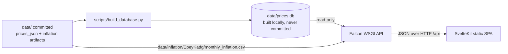

# Architecture

This file owns the source layout, layer boundaries, request flow, coding conventions and the list of known code issues. Setup commands are in [GETTING-STARTED.md](GETTING-STARTED.md).

## System boundary

This repository contains the serving and presentation tiers. Scrapers, inflation calculators and TÜİK methodology live in the separate data repository; their **output** is committed here under `data/` (`prices_json/` price histories, `inflation/` artifacts, and reference files in `raw/`). See [DATA_CONTRACT.md](DATA_CONTRACT.md).



## Source layout

```text
inflation_dashboard/
  domain/prices.py                 price/date normalization, HISTORY_COLUMNS, product details (brand, barcode, URLs, regular price)
  domain/catalog.py                catalog rules: name_key (search text), split_retailer, excluded groups
  domain/matching.py               match keys (same product across stores), family keys, overrides, permanent IDs
  domain/product_attributes.py     title parser (brand, size, pack, attributes, model codes) and unit prices
  domain/price_cleaning.py         rules for placeholder, dotted-thousands and case prices (used by the build)
  application/use_cases.py         history, averages, movers, coverage calculations (pandas)
  application/chart_specs.py       column contracts for each response table
  application/epeykatfg_monthly.py reads the EpeyKatfg monthly inflation CSV
  adapters/sqlite_price_repository.py  read-only SQLite connections and the dashboard queries
  adapters/sqlite_catalog_repository.py  catalog queries (groups, search, item, deals) for /api/catalog/*
  api/falcon_app.py                create_app(): routes, middleware, error handlers
  api/resources.py                 one resource class per endpoint
  api/filters.py                   filter parsing, history loading, in-process caches
  api/serialization.py             {data, meta, errors} envelope, JSON-safe conversion
scripts/
  run_falcon_server.py             launcher (Granian / Gunicorn / Waitress)
  build_database.py                builds data/prices.db from data/
  csv_to_json.py                   merges scraper CSVs into the per-retailer data/prices_json files
  build_brand_list.py              builds data/matching/brands.json for the title parser
  assign_ids.py                    appends the build's new item/family IDs to data/matching/ids.json
  data_files.py                    split/join/check files over the 85 MB limit
  verify_falcon_api.py             in-process API smoke and boundary checks
  test_sqlite_adapter.py, test_new_endpoints.py, benchmark_*.py   manual tooling
tests/                             pytest suite
frontend/src/
  app.html, app.css, app.d.ts      page shell, global styles, ambient types
  routes/+layout.ts                ssr = false (pure client-side SPA)
  routes/+layout.svelte            root layout: imports app.css, applies the colour theme
  routes/(shop)/                   price-comparison shop (layout group, no URL segment): SiteHeader + footer layout,
                                   / home, /ara search, /urun/[key] item (<slug>,<id>), /firsatlar deals, /alarmlar price alarms
  routes/analiz/+page.svelte       inflation dashboard at /analiz: inventory load, sidebar, five view tabs
  lib/api/client.ts                fetchApi(): the only HTTP client
  lib/stores/filters.svelte.ts     global filter state (Svelte 5 runes)
  lib/stores/catalog.svelte.ts     catalog groups, loaded once from /api/catalog/groups
  lib/stores/alarms.svelte.ts      price alarms in localStorage (`price-alarms`)
  lib/catalog.ts                   shop helpers: Turkish group labels, item (/urun/<slug>,<id>) and search links, TL formatting
  lib/types/api.ts                 TypeScript mirror of the API contract
  lib/themes.svelte.ts             Auto/Light/Dark theme state
  lib/components/                  Header, Sidebar, Chart, DataTable, selects, alerts; shop: SiteHeader, ProductCard, Icon
  lib/views/                       ProductExplorer, RetailerAverages, PriceMovers, CoverageOverview, EpeyKatfgMonthly
  lib/utils/                       ECharts options/theme, formatting, fuzzy search, AsyncResource loader
  lib/index.ts                     $lib alias entry (empty)
```

## Layer boundaries

- `domain/`, `application/` and `adapters/` do not import Falcon, Streamlit, Plotly or frontend code.
- `api/` owns HTTP concerns. It must not import `sqlite3`, Redis, SQLAlchemy or other database/cache clients; database access goes through `adapters/sqlite_price_repository.py` and `adapters/sqlite_catalog_repository.py`. The in-process caches in `api/filters.py` are stdlib-only.
- `HealthResource` must not touch inventory or history loading, so `/api/health` stays cheap.
- `frontend/` talks to the server only through the HTTP API, via `frontend/src/lib/api/client.ts`. It never reads data files.
- `scripts/verify_falcon_api.py` enforces the import rules above.

## Request flow

1. The SPA calls `fetchApi()`, which builds `<base>/api/...`. With an empty `VITE_API_BASE_URL` (the default) the URL is relative, so the browser calls its own origin; the Vite dev proxy or a production reverse proxy forwards `/api` to Falcon. See [CONFIGURATION.md](CONFIGURATION.md).
2. Falcon (WSGI only) runs `TimingMiddleware` and `CORSMiddleware`, then the resource for the route.
3. The resource first checks the pre-serialized response cache (`api/filters.py`, 5-minute TTL, gzip variant and strong ETag per entry). A hit is served as 200 or 304.
4. On a miss, filter endpoints parse and validate the common filters (cached per query signature), then load the matching history frame from SQLite (cached per filter signature) via `sqlite_price_repository.load_price_history_from_db`.
5. Application use cases compute the response tables in pandas; `api/serialization.py` converts them to JSON-native values inside the envelope; the bytes are cached and sent.
6. `/api/products` (product names per retailer, used by the Product explorer's pickers) queries the `products` table, and `/api/products/search` and `/api/product` query the `product_prices` view, through the adapter directly. `/api/epeykatfg/monthly-inflation` reads the monthly inflation CSV.
7. `/api/catalog/*` (the shop) calls `adapters/sqlite_catalog_repository.py`, which reads the `products`, `items`, `families`, `categories`, `retailers` and `observations` tables over the same read-only connections. Items are products that share `products.name_key` (`domain/catalog.py`); only current offers (`is_current`) are listed. Search counts only each store's latest offers (`is_store_latest`), and an item lists one offer per store (the cheapest on the store's newest date) with the store's other offers under `other_offers`.
8. Errors: filter validation returns 400 `invalid_filter`; a missing or empty database returns 503 `database_unavailable`, and a database built before the catalog columns returns 503 `database_outdated` on `/api/catalog/*`; unknown routes, wrong methods and unhandled exceptions are rendered as envelopes by the error handlers in `create_app`. The SQLite database is the only data path.

## Conventions

### API

- Every response, including errors, uses `{data, meta, errors}`; error objects are `{code, message}`.
- Serialized values are JSON-native: no pandas/numpy scalars, `NaN` or `NaT`.
- Resources stay thin and delegate to application use cases; database access belongs in adapters.
- `frontend/src/lib/types/api.ts` and [FALCON_API_CONTRACT.md](FALCON_API_CONTRACT.md) change together with any endpoint change.

### Frontend

- Svelte 5 runes are the state model.
- The SPA is static and client-only (`ssr = false`, `adapter-static` with an `index.html` fallback).
- Shop pages are in Turkish and live in the `(shop)` route group; the inflation dashboard lives at `/analiz`. Browser-only state such as price alarms uses `localStorage`; the API stays read-only.
- All server data access goes through `frontend/src/lib/api/client.ts`.

### Database

- `data/prices.db` is generated by `scripts/build_database.py` and never committed.
- API request connections are read-only.
- Schema and index changes update `scripts/build_database.py`, `tests/test_build_database.py` and [DATABASE.md](DATABASE.md) together.
- Scraper and inflation-calculation source code stays in the data repository; only its output is committed under `data/`.

### Documentation

- Current docs live directly under `docs/`, one owning file per topic (see the [index](README.md)).
- Dated research is under `docs/research/` and the dated `FALCON-*` reports; only their links are maintained.
- Monorepo and Streamlit history is under `docs/archive/` and is labeled historical.

## Operational notes

- **Database availability:** the API starts without a database, but data endpoints return 503 until `data/prices.db` is built. Deployment should build and check the database before taking traffic.
- **Rebuilds:** `build_database.py` writes `<db>.building` and swaps it in with `os.replace`; restart the API after a rebuild because workers keep per-thread connections and 5-minute caches.
- **SQLite concurrency:** read-only connections, WAL mode, one reusable reader per worker thread, bounded worker/thread counts.
- **Payload size:** unfiltered history can be tens of MB. Keep the bounded defaults (`max_files`), gzip/ETag and response caching.
- **Cross-repository data:** retailer labels, product identity rules, date formats and inflation columns must stay compatible with the data repository's output.
- **Security:** CORS defaults to `*`; restrict `FALCON_CORS_ORIGINS` in production. Keep secrets out of Git. The API exposes no write path.

## Deployment topology

```text
nginx/Caddy
  ├── /         → static Svelte build (frontend/build, index.html fallback)
  └── /api/*    → Falcon on Granian/Gunicorn (WSGI)
                    └── read-only data/prices.db
```

The API and SPA can also run on separate origins: set `VITE_API_BASE_URL` at build time and allow the SPA origin in `FALCON_CORS_ORIGINS`. A reverse-proxy example is in [GETTING-STARTED.md](GETTING-STARTED.md).

## Known issues

Code defects that are documented rather than fixed:

| Issue | Location | Impact |
|---|---|---|
| Nothing loads a `.env` file (no dotenv). `.env.example` only lists variables; they must be exported in the shell or service environment. | `.env.example:1`; variables are read with `os.environ` in `inflation_dashboard/adapters/sqlite_price_repository.py:36` and `inflation_dashboard/application/epeykatfg_monthly.py:20` | Copying `.env.example` to `.env` has no effect on the API. (Vite does load `frontend/.env` for `VITE_*` variables.) |
| The client type `InventoryMeta.warnings` has no counterpart in server output: `/api/inventory` never sends `meta.warnings`. | `frontend/src/lib/types/api.ts:91`, read at `frontend/src/routes/analiz/+page.svelte:43` | The sidebar's inventory warnings list is always empty. |
