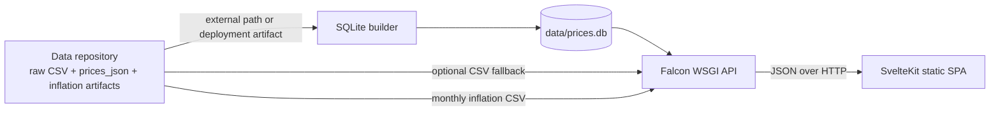

# Architecture

## System boundary

This repository contains the presentation and serving tiers only. Data acquisition and inflation computation are owned by the separate `inflationstudymirror` repository.



## Components

| Component | Path | Responsibility |
|---|---|---|
| Svelte SPA | `frontend/` | Dashboard views, filters, charts and API client |
| Falcon API | `inflation_dashboard/api/` | Routing, validation, serialization, caching and middleware |
| Application layer | `inflation_dashboard/application/` | History, averages, movers, coverage and chart contracts |
| Domain layer | `inflation_dashboard/domain/` | Price/date normalization and shared data contracts |
| SQLite adapter | `inflation_dashboard/adapters/sqlite_price_repository.py` | Read-only WAL database access and query optimization |
| CSV fallback | `inflation_dashboard/adapters/csv_price_repository.py` | Optional bounded reads from externally mounted raw CSV |
| Database tooling | `scripts/build_database.py`, `scripts/data_files.py` | Build the serving database from the committed `data/` tree; split/join files over 85 MB |

## Runtime flow

1. The data repository publishes raw CSV, partitioned JSON and generated inflation artifacts.
2. The web repository builds or receives a versioned SQLite snapshot.
3. Falcon opens the database read-only with WAL, mmap and bounded cache settings.
4. API resources route through application use cases and JSON-safe serialization.
5. The Svelte SPA consumes the stable HTTP envelope and renders five dashboard views.

## Module boundaries

- Domain, application and adapter modules do not import Falcon or frontend frameworks.
- API resources do not access `sqlite3` directly.
- The browser client does not import Python modules or scan data files.
- Raw CSV fallback is optional and bounded; SQLite is the production serving path.
- External artifact paths are configured through environment variables, never hard-coded sibling repository paths.

## Deployment topology

Recommended production deployment:

```text
nginx/Caddy
  ├── /                 → static Svelte build
  └── /api/*            → Falcon/Granian (WSGI)
                              └── read-only data/prices.db
```

The API and frontend may also be deployed as separate services. Set `VITE_API_BASE_URL` at build time or configure CORS for a cross-origin frontend.
